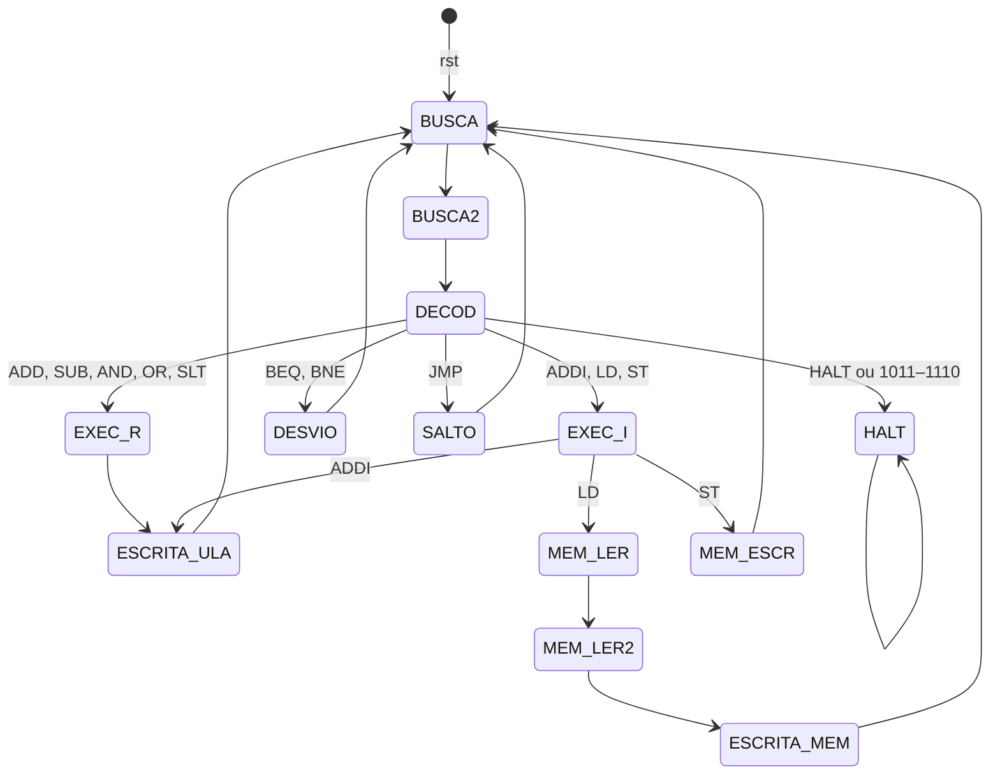

# Unidade de controle

Seção do relatório (P2). O código está em `rtl/unidade_controle.vhd` e o teste em `tb/unidade_controle_tb.vhd`. O diagrama editável está em `doc/estados.drawio`.

## Funcionamento

A unidade de controle é uma máquina de estados de **Moore** com 13 estados. As saídas dependem só do estado atual. Há duas exceções, e as duas dependem só do opcode:

- **ULACtl no EXEC_R:** o opcode tipo R é traduzido na operação da ULA (decisão D1).
- **RegSrc2:** vale 1 para ST, BEQ e BNE em qualquer estado (decisão D3).

O registrador de estado guarda diretamente o código de 4 bits definido no `cpu_pkg`. Esse mesmo código sai em `Estado` e aparece em LEDG[3:0].

- **Clock:** tudo roda em `CLOCK_50`. O estado só muda numa borda de subida em que `en = 1`, ou seja, um estado por aperto de KEY0.
- **Reset:** `rst` é assíncrono e leva a FSM para BUSCA (0000).
- **Entrada:** só o `opcode` (RI[15:12]). A flag Zero da ULA **não** entra na unidade de controle: a condição do desvio é calculada no `cpu.vhd` (decisão D2).

## Diagrama de estados

Todas as transições acontecem só quando `en = 1`. As setas sem condição são incondicionais.



Caminho de cada instrução:

| Instrução | Estados | Passos |
|---|---|---|
| ADD, SUB, AND, OR, SLT | BUSCA → BUSCA2 → DECOD → EXEC_R → ESCRITA_ULA | 5 |
| ADDI | BUSCA → BUSCA2 → DECOD → EXEC_I → ESCRITA_ULA | 5 |
| LD | BUSCA → BUSCA2 → DECOD → EXEC_I → MEM_LER → MEM_LER2 → ESCRITA_MEM | 7 |
| ST | BUSCA → BUSCA2 → DECOD → EXEC_I → MEM_ESCR | 5 |
| BEQ, BNE | BUSCA → BUSCA2 → DECOD → DESVIO | 4 |
| JMP | BUSCA → BUSCA2 → DECOD → SALTO | 4 |
| HALT (e opcodes livres) | BUSCA → BUSCA2 → DECOD → HALT | fica em HALT |

## Tabela de estados

| Cód. | Estado atual | Condição (opcode) | Próximo estado |
|---|---|---|---|
| 0000 | BUSCA | – | BUSCA2 |
| 0001 | BUSCA2 | – | DECOD |
| 0010 | DECOD | 0000 a 0100 (ADD, SUB, AND, OR, SLT) | EXEC_R |
| | | 0101, 0110, 0111 (ADDI, LD, ST) | EXEC_I |
| | | 1000, 1001 (BEQ, BNE) | DESVIO |
| | | 1010 (JMP) | SALTO |
| | | 1111 (HALT) ou 1011 a 1110 (livres, D6) | HALT |
| 0011 | EXEC_R | – | ESCRITA_ULA |
| 0100 | EXEC_I | 0101 (ADDI) | ESCRITA_ULA |
| | | 0110 (LD) | MEM_LER |
| | | 0111 (ST) | MEM_ESCR |
| 0101 | ESCRITA_ULA | – | BUSCA |
| 0110 | MEM_LER | – | MEM_LER2 |
| 0111 | MEM_LER2 | – | ESCRITA_MEM |
| 1000 | ESCRITA_MEM | – | BUSCA |
| 1001 | MEM_ESCR | – | BUSCA |
| 1010 | DESVIO | – | BUSCA |
| 1011 | SALTO | – | BUSCA |
| 1100 | HALT | – | HALT (só sai com reset) |

Os códigos 1101 a 1111 não são estados. Se o registrador de estado cair num deles, a FSM volta para BUSCA no passo seguinte.

## Sinais de controle

### Significado

| Sinal | Bits | Valor 0 | Valor 1 (ou outros códigos) |
|---|---|---|---|
| PCWrite | 1 | PC mantém o valor | PC carrega `pc_prox` |
| PCWriteCond | 1 | – | PC carrega `pc_prox` se a condição do desvio valer (D2) |
| PCSource | 2 | 00: saída da ULA (PC + 1) | 01: SaídaULA (destino do desvio); 10: `"0000" & end` (JMP) |
| IorD | 1 | Endereço da memória = PC | Endereço da memória = SaídaULA |
| MemWrite | 1 | Não escreve | Escreve B na memória (`wren`, D7) |
| IRWrite | 1 | RI mantém | RI carrega a saída da memória |
| RDMWrite | 1 | RDM mantém | RDM carrega a saída da memória |
| RegWrite | 1 | Banco não escreve | Escreve em R[Ri] (ignorado se Ri = R0) |
| RegSrc2 | 1 | 2ª leitura do banco = Rk (RI[5:3]) | 2ª leitura do banco = Ri (RI[11:9]), para ST, BEQ e BNE |
| MemtoReg | 1 | Dado escrito no banco = SaídaULA | Dado escrito no banco = RDM |
| ULASrcA | 1 | Entrada A da ULA = PC | Entrada A da ULA = registrador A |
| ULASrcB | 2 | 00: registrador B | 01: constante 1; 10: imediato estendido |
| ULACtl | 3 | 000: AND | 001: OR; 010: soma; 100: subtração; 110: SLT |
| Halt | 1 | CPU rodando | CPU parada (LEDG8) |
| Estado | 4 | – | Código do estado atual (LEDG[3:0]) |

### Valor em cada estado

Campo vazio vale 0 (ou 00, 000). RegSrc2 não aparece: vale 1 sempre que o opcode é ST, BEQ ou BNE, em qualquer estado (D3).

| Estado | PCWrite | PCWriteCond | PCSource | IorD | MemWrite | IRWrite | RDMWrite | RegWrite | MemtoReg | ULASrcA | ULASrcB | ULACtl | Halt |
|---|---|---|---|---|---|---|---|---|---|---|---|---|---|
| BUSCA | | | | 0 | | | | | | | | | |
| BUSCA2 | 1 | | 00 | 0 | | 1 | 1 | | | 0 | 01 | 010 | |
| DECOD | | | | | | | | | | 0 | 10 | 010 | |
| EXEC_R | | | | | | | | | | 1 | 00 | D1 | |
| EXEC_I | | | | | | | | | | 1 | 10 | 010 | |
| ESCRITA_ULA | | | | | | | | 1 | 0 | | | | |
| MEM_LER | | | | 1 | | | | | | 1 | 10 | 010 | |
| MEM_LER2 | | | | 1 | | | 1 | | | 1 | 10 | 010 | |
| ESCRITA_MEM | | | | | | | | 1 | 1 | | | | |
| MEM_ESCR | | | | 1 | 1 | | | | | | | | |
| DESVIO | | 1 | 01 | | | | | | | 1 | 00 | 100 | |
| SALTO | 1 | | 10 | | | | | | | | | | |
| HALT | | | | | | | | | | | | | 1 |

ULACtl no EXEC_R (D1):

| Opcode | Instrução | ULACtl |
|---|---|---|
| 0000 | ADD | 010 |
| 0001 | SUB | 100 |
| 0010 | AND | 000 |
| 0011 | OR | 001 |
| 0100 | SLT | 110 |

### Por que alguns estados repetem a conta da ULA

A, B e SaídaULA carregam a cada passo, sem sinal de escrita próprio (D4). Por isso:

- **MEM_LER e MEM_LER2** repetem A + imm (D5). Assim a SaídaULA, que é o endereço da leitura, não muda entre os dois passos. Na placa a RAM roda em `CLOCK_50` e relê o endereço o tempo todo; sem a repetição, o LD leria o endereço errado.
- **DECOD** já calcula PC + imm, o destino de um possível desvio. O PC já foi incrementado no BUSCA2, então o destino fica (PC + 1) + imm. No DESVIO a ULA faz A − B só para gerar Zero. O PC pega a SaídaULA antiga (o destino) na mesma borda em que ela recebe A − B.

## Teste (`unidade_controle_tb.vhd`)

O testbench guarda a tabela "Valor em cada estado" como uma constante. Para cada instrução, ele percorre todos os estados e confere o código do estado e os 14 sinais contra essa tabela. Também confere:

| Caso | Como é conferido |
|---|---|
| As 11 instruções e o HALT | Sequência de estados completa e todos os sinais em cada estado |
| ULACtl de cada tipo R (D1) | ADD, SUB, AND, OR e SLT conferidos no EXEC_R |
| RegSrc2 (D3) | Conferido em todos os estados de todas as instruções |
| `en = 0` segura o estado | Antes de cada passo há um ciclo sem `en`, e nada pode mudar |
| Desvio tomado e não tomado | No DESVIO, o TB aplica a lógica do `cpu.vhd` (D2) com Zero = 0 e Zero = 1, para BEQ e BNE |
| HALT parado | Três pulsos de `en` em HALT e o estado não muda |
| Opcodes livres, 1011 a 1110 (D6) | Cada um vai para HALT e fica lá |
| Reset assíncrono | `rst` no meio de um LD (MEM_LER) e no HALT volta para BUSCA sem esperar borda |

No Transcript do ModelSim:

```
do tb/rodar.do unidade_controle_tb
```

O resultado esperado é `TODOS OS TESTES PASSARAM (unidade_controle)`.
